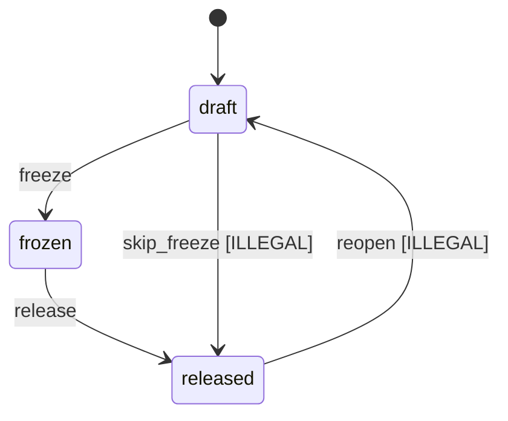

# Requirement Truth: docs-version-line

## 人话

beacon-go 同时跑两条版本轴：二进制自己的 runtime 版本（version.go）和每个项目自己的 docs 交付版本（docs/beacon/<v>/）。这个需求管 docs 那条轴：版本只能是纯 X.Y.Z，能按 patch/minor/major 开下一条线，manifest 有基线→草稿→冻结→发布的生命周期，不同项目同一个版本号互不干扰。

## 用户旅程

| 步骤 | 角色 | 动作 | 可观察结果 |
|---|---|---|---|
| 1 | 开发者 | 注册项目并创建 v0.0.1 docs 版本 | 项目有 current docs 版本，版本号为纯 vX.Y.Z |
| 2 | 开发者 | 执行 bump 开下一条线 | 新版本 manifest 为 draft，旧版本不变，两项目同名版本互不干扰 |
| 3 | 开发者 | 对 draft 执行 freeze 再 release | 状态合法推进到 released；非法跳转被拒绝且状态不变 |

## User Intent Snapshot

```yaml
utterance: "纯 x.y.z 版本演进；严格区分 runtime 版本与需求树文档版本；两轴平时独立、发布时对齐；任何项目不共享彼此的文档版本号"
goal: "docs 版本线按 project_id 隔离管理，纯 X.Y.Z 格式，manifest 状态机 draft->frozen->released 有非法转移防护"
non_goals: "不改 runtime 版本规则（属 runtime-version-source）；不自动对齐两轴（属 dual-axis-alignment）；不改节点 id 命名空间（属 node-id-namespace）"
constraints: "docs 版本拒绝 runtime 形态 x.y.z-go.N；bump 默认 patch，minor/major 显式；manifest 状态转移必须合法"
scope_mode: focused
```

## Open Questions

| Q ID | Question | Recommendation | Status | Answer |
|---|---|---|---|---|
| Q1 | 用户要获得什么可验证结果，哪些工作明确不做？ | 版本格式校验、bump、manifest 生命周期可观测；不做双轴自动对齐 | answered | 可验证：NormalizeDocsVersion 拒绝 runtime 形态、BumpDocsVersion 三级递增、version manifest draft/frozen/released 转移合法且非法拒绝；不做 runtime 对齐与 id 命名空间 |
| Q2 | 本需求是否有领域状态与安全拒绝路径？ | manifest 有明确状态机，非法转移必须拒绝 | answered | fsm_required=true：manifest 生命周期 draft->frozen->released；negative_required=true：非法转移（released->draft、draft->released）必须拒绝 |

## Grounding

| Source | Reference | Supports |
|---|---|---|
| 源码 | internal/orchestrator/versioning.go:NormalizeDocsVersion,BumpDocsVersion | 纯 X.Y.Z 解析与 bump |
| 源码 | internal/orchestrator/version_manifest.go:BaselineVersion,OpenVersion,FreezeVersion,ReleaseVersion | manifest 生命周期 |
| 源码 | internal/versionmanifest/manifest.go:StatusDraft/Frozen/Released | 状态枚举 |
| 源码 | internal/store/dao.go:AddVersion,CurrentVersion,ListVersions | project_id 隔离 |
| CLI | beacon version baseline/open/freeze/release/status | manifest 命令面 |
| CLI | beacon projects bump --level patch\|minor\|major | 项目级版本递增 |

## Assumptions

- 假设 project 已注册且有 current docs 版本（projects register --version）；bump 在此基础上开下一条线。确认依据：projects.go ensureVersion + bump 命令。
- 假设 manifest freeze/release 的前置 gate 条件（qa=pass、无 open changes）由既有 version 子命令强制，本包只覆盖状态转移合法性与非法拒绝。

## Intent Coverage

| AC ID | Intent Source | Evidence |
|---|---|---|
| AC-001 | utterance「纯 x.y.z 版本演进」 | NormalizeDocsVersion 拒绝 runtime 形态、BumpDocsVersion patch/minor/major |
| AC-002 | utterance「任何项目不共享彼此的文档版本号」 | projects bump/list 按 project_id 隔离，版本记录在 project_versions |
| AC-003 | domain_fsm draft->frozen->released | version freeze/release 合法转移；非法转移返回错误 |

## Acceptance Criteria

| AC ID | Criterion |
|---|---|
| AC-001 | NormalizeDocsVersion 接受 X.Y.Z 和 vX.Y.Z 并归一为 vX.Y.Z；拒绝 runtime 形态（含 -go.N）和非法字符串；BumpDocsVersion 支持 patch/minor/major 三级递增，默认 patch |
| AC-002 | projects bump 在已注册项目上创建下一 docs 版本并置为 current；版本记录按 project_id 隔离，不同项目可独立持有同名版本号而互不影响 |
| AC-003 | version manifest 状态机支持 draft->frozen->released 合法转移；released->draft 与 draft->released 的非法转移被拒绝且状态不变 |

## Coverage Matrix

| AC ID | TC ID | Layer | Command | Assertion | Evidence | Required Tests |
|---|---|---|---|---|---|---|
| AC-001 | TC-001 | unit | `go test ./internal/orchestrator -run TestBumpDocsVersion$ -count=1` | BumpDocsVersion patch/minor/major 递增正确，非法 level 与 runtime 形态被拒绝 | evidence/TC-001.txt | TC-001 |
| AC-001 | TC-002 | negative | `go test ./internal/orchestrator -run TestDocsVersionNormalizeAndUnregistered$ -count=1` | runtime 形态 2.0.0-go.12 与非法字符串被拒绝 | evidence/TC-002.txt | TC-002 |
| AC-002 | TC-003 | unit | `go test ./internal/store -run TestProjectVersionFeatureConstraints$ -count=1` | 同一项目版本单 current 约束成立，版本记录按 project_id 隔离 | evidence/TC-003.txt | TC-003 |
| AC-002 | TC-004 | negative | `go test ./internal/store -run TestTwoProjectsSameVersionName$ -count=1` | 项目 A 的版本列表不包含项目 B 的同名版本记录 | evidence/TC-004.txt | TC-004 |
| AC-003 | TC-005 | unit | `go test ./internal/orchestrator -run TestManifestIllegalTransitions$ -count=1` | draft->frozen->released 合法转移成功 | evidence/TC-005.txt | TC-005 |
| AC-003 | TC-006 | negative | `go test ./internal/orchestrator -run TestManifestIllegalTransitions$ -count=1` | draft->released 与 released 上 freeze 被拒绝，状态不变 | evidence/TC-006.txt | TC-006 |

## FSM



| From | To | Trigger | Guard | Side effect | Terminal |
|---|---|---|---|---|---|
| draft | frozen | freeze | manifest 为 draft 且 gate 条件满足 | 写入 frozen_at，状态 frozen | no |
| frozen | released | release | manifest 为 frozen | 写入 released_at，状态 released | yes |

## Illegal Transitions

| From | To | Trigger | Reason | Source |
|---|---|---|---|---|
| released | draft | reopen | released 为终态，不允许回退 | domain_fsm.illegal |
| draft | released | skip_freeze | 必须先 freeze 才能 release | domain_fsm.illegal |

## Transition Coverage

| From | To | Trigger | TC ID |
|---|---|---|---|
| draft | frozen | freeze | TC-005 |
| frozen | released | release | TC-005 |
| released | draft | reopen | TC-006 |
| draft | released | skip_freeze | TC-006 |

## 未做

- 不实现 runtime 版本与 docs 版本发布时自动对齐（dual-axis-alignment）。
- 不修改 version.go/runtime 版本规则（runtime-version-source）。
- 不迁移历史 manifest 格式；只约束本包定义的状态转移。
