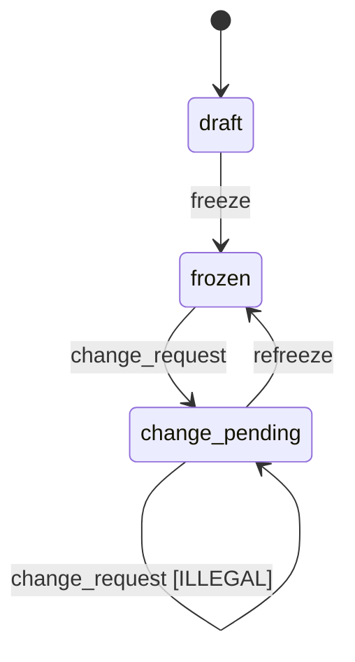

# Requirement Truth: intent-tree-crud

## 人话

意图树的节点不能随手物理删改；增加要过 schema 校验，状态推进要过 stage gate，已冻结真相的变更必须走 change request 进入 change_pending，改完 refreeze 回 frozen。删是作废链路，不是物理删除，真相可追溯。

## 用户旅程

| 步骤 | 角色 | 动作 | 可观察结果 |
|---|---|---|---|
| 1 | 开发者 | 通过 plan apply 提交子节点提案 | schema DAG 校验通过才落盘，非法提案被拒绝 |
| 2 | 开发者 | 推进 feature 节点从 draft 到 frozen/verified | stage gate 按状态放行或拒绝，不满足前置则阻断 |
| 3 | 开发者 | 对 frozen 节点发起 change request | 节点进入 change_pending，truth body 不被物理改写，refreeze 后恢复 frozen |

## User Intent Snapshot

```yaml
utterance: "为意图树节点提供显式增删改入口；删除走 change request 作废链路而非物理删除，保持真相可追溯"
goal: "节点增改有校验门禁，冻结真相变更走 change_pending 作废链路，可追溯"
non_goals: "不做树节点物理删除；不覆盖 tree UI 渲染；不实现跨版本自动迁移"
constraints: "非法子节点提案拒绝；change_pending 时冻结/refreeze 以外的推进被阻断；truth body 在 change request 时不被改写"
scope_mode: focused
```

## Open Questions

| Q ID | Question | Recommendation | Status | Answer |
|---|---|---|---|---|
| Q1 | 用户要获得什么可验证结果，哪些工作明确不做？ | 增有校验、改有门禁、删走作废链路；不做物理删除和 UI | answered | 可验证：ValidateChildMatrix 拒绝非法提案、StageGateFeatureLifecycle 按状态门禁、TruthChangeAndRefreeze 走 change_pending 且 truth body 不改 |
| Q2 | 本需求是否有领域状态与安全拒绝路径？ | 节点生命周期有 FSM，非法转移必须拒绝 | answered | fsm_required=true；negative_required=true；非法提案/非法转移/重复 change 拒绝 |

## Grounding

| Source | Reference | Supports |
|---|---|---|
| 源码 | internal/intenttree/validate.go:ValidateChild | 子节点 schema DAG 校验 |
| 源码 | internal/intenttree/stagegate.go:StageGate | feature lifecycle stage gate |
| 源码 | internal/orchestrator/truth_change.go:RequestTruthChange,RefreezeTruthPackage | change request/refreeze 链路 |
| 源码 | internal/orchestrator/frozen_fact.go | change_pending 使 frozen fact 失效 |
| 测试 | internal/intenttree/validate_test.go:TestValidateChildMatrix | 非法子节点拒绝 |
| 测试 | internal/intenttree/stagegate_test.go:TestStageGateFeatureLifecycle | 状态门禁 |
| 测试 | internal/orchestrator/truth_test.go:TestTruthChangeAndRefreeze | change/refreeze 链路 |
| 测试 | internal/orchestrator/frozen_fact_test.go:TestFrozenFactChangePendingVoidsFrozen | change_pending 阻断 |

## Assumptions

- 假设“删除=作废链路”在当前实现中对应 change request/deprecate 路径，不提供物理删除 API；本包以 change request/refreeze 链路为可验证证据。
- 假设 tree 节点 FSM 与 legacy package 状态机在 change_pending/refreeze 语义上一致，以现有 orchestrator 测试为证据。

## Intent Coverage

| AC ID | Intent Source | Evidence |
|---|---|---|
| AC-001 | utterance「显式增删改入口」之增 | ValidateChildMatrix 拒绝非法提案 |
| AC-002 | domain_fsm draft/frozen/change_pending/deprecated 状态推进 | StageGateFeatureLifecycle 按状态放行/拒绝 |
| AC-003 | utterance「删除走 change request 作废链路而非物理删除，保持真相可追溯」 | TruthChangeAndRefreeze + FrozenFactChangePendingVoidsFrozen |

## Acceptance Criteria

| AC ID | Criterion |
|---|---|
| AC-001 | 子节点提案经 schema DAG 校验；合法提案通过，非法形态（非法 kind、坏父子关系、退化树）被拒绝 |
| AC-002 | feature 节点生命周期受 stage gate 约束：draft feature 阻断 truth，draft leaf 阻断 implement，frozen leaf 允许 implement，verified 允许 qa/release |
| AC-003 | frozen 真相发起 change request 后进入 change_pending 且 truth body 不被物理改写；重复 change 和 change_pending 期间 freeze 被拒绝；refreeze 后恢复 frozen 且 change_pending 清除 |

## Coverage Matrix

| AC ID | TC ID | Layer | Command | Assertion | Evidence | Required Tests |
|---|---|---|---|---|---|---|
| AC-001 | TC-001 | unit | `go test ./internal/intenttree -run 'TestValidateChildMatrix$' -count=1` | 合法子节点通过，非法形态被拒绝 | evidence/TC-001.txt | TC-001 |
| AC-001 | TC-002 | negative | `go test ./internal/intenttree -run 'TestValidateIndexCatchesDegenerateTrees$' -count=1` | 退化树/非法索引被校验捕获 | evidence/TC-002.txt | TC-002 |
| AC-002 | TC-003 | unit | `go test ./internal/intenttree -run 'TestStageGateFeatureLifecycle$' -count=1` | 状态满足前置时 gate 放行 | evidence/TC-003.txt | TC-003 |
| AC-002 | TC-004 | negative | `go test ./internal/intenttree -run 'TestStageGateFeatureLifecycle$' -count=1` | 状态不满足前置时 gate 拒绝并给出原因 | evidence/TC-004.txt | TC-004 |
| AC-003 | TC-005 | unit | `go test ./internal/orchestrator -run 'TestTruthChangeAndRefreeze$' -count=1` | change request 进入 change_pending，truth body 不变，refreeze 恢复 frozen | evidence/TC-005.txt | TC-005 |
| AC-003 | TC-006 | negative | `go test ./internal/orchestrator -run 'TestFrozenFactChangePendingVoidsFrozen$' -count=1` | change_pending 使 frozen fact 失效并阻断 admission | evidence/TC-006.txt | TC-006 |

## FSM



| From | To | Trigger | Guard | Side effect | Terminal |
|---|---|---|---|---|---|
| draft | frozen | freeze | 退出条件满足 | 节点/包冻结 | no |
| frozen | change_pending | change_request | 节点已 frozen | 记录 change，truth body 不改写 | no |
| change_pending | frozen | refreeze | change 已解决 | 恢复 frozen，清除等待标记 | no |

## Illegal Transitions

| From | To | Trigger | Reason | Source |
|---|---|---|---|---|
| change_pending | change_pending | change_request | 同一时刻只允许一个未解决的变更请求 | truth_change.go |

## Transition Coverage

| From | To | Trigger | TC ID |
|---|---|---|---|
| draft | frozen | freeze | TC-005 |
| frozen | change_pending | change_request | TC-005 |
| change_pending | frozen | refreeze | TC-005 |
| change_pending | change_pending | change_request | TC-006 |

## 未做

- 不提供树节点物理删除 API；作废只走 change request/deprecate 链路。
- 不覆盖 tree HTML 渲染与 UI 交互（tree-visual 模块）。
- 不实现跨版本节点自动迁移（version-evolution 模块）。
